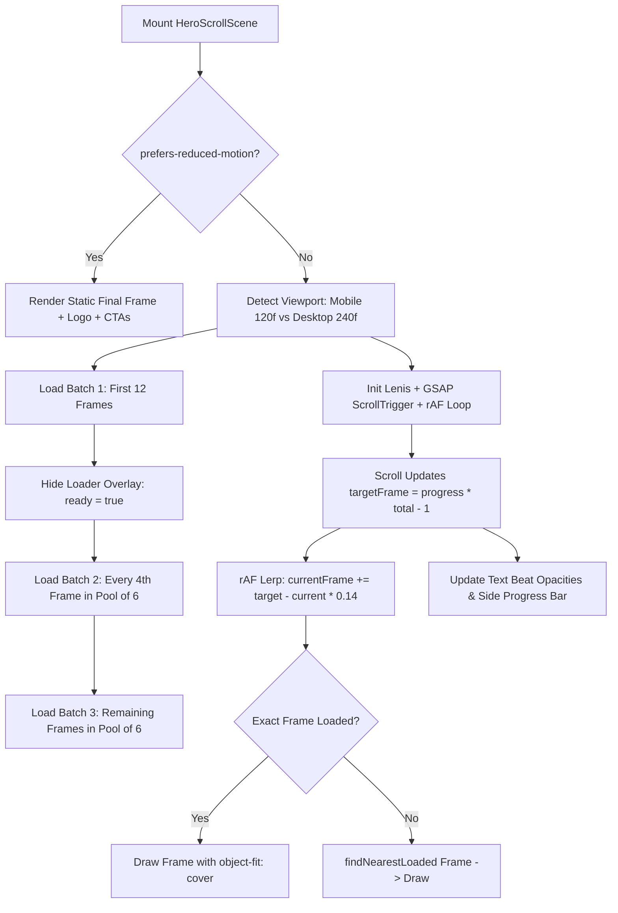

# 02 — Hero Scroll Flow (`components/HeroScrollScene.tsx`)

## 1. Canvas & Viewport Architecture
- **Outer Scroll Track:** `h-[400vh]` on mobile (`< 768px`) and `md:h-[500vh]` on desktop (`>= 768px`).
- **Sticky Stage:** `sticky top-0 h-[100dvh] w-full overflow-hidden bg-[#378FC8]`.
- **Canvas Rendering:**
  - `getContext("2d", { alpha: false })`.
  - `resizeCanvas()` sets `canvas.width = rect.width * dpr` and `canvas.height = rect.height * dpr` where `dpr = Math.min(window.devicePixelRatio || 1, 2)`.
  - `drawCover(img)` computes `scale = Math.max(cw / iw, ch / ih)` to replicate `object-fit: cover` centered.
- **Scroll & Smoothing:**
  - `Lenis` (`duration: 1.15`, exponential ease-out) syncs with GSAP via `lenis.on("scroll", ScrollTrigger.update)` and `gsap.ticker.add(...)` with `gsap.ticker.lagSmoothing(0)`.
  - `ScrollTrigger.create({ trigger: containerRef.current, start: "top top", end: "bottom bottom", scrub: true })` maps scroll progress `p` (`0..1`) to `targetFrameRef.current = p * (total - 1)`.
  - `requestAnimationFrame` loop interpolates `currentFrameRef.current += (targetFrameRef.current - currentFrameRef.current) * 0.14` and draws only when `Math.round(currentFrameRef.current) !== lastDrawnIndexRef.current`.

## 2. Progressive Frame Loading
- **Desktop (`>= 768px`):** `240` frames from `/frames/frame_001.webp` .. `frame_240.webp`.
- **Mobile (`< 768px`):** `120` frames from `/frames-mobile/frame_001.webp` .. `frame_120.webp`.
- **3-Batch Strategy:**
  1. **Batch 1 (Blocking Loader):** First `12` frames (`0..11`). Updates `loadPercent` (`0..100%`). Once complete, `setReady(true)` hides the loader.
  2. **Batch 2 (Scrubbing Skeleton):** Every 4th frame (`12, 16, 20...`) loaded via a 6-worker concurrency pool.
  3. **Batch 3 (Background Fill):** Remaining frames loaded via a 6-worker pool.
- **Fallback:** `findNearestLoaded(targetIdx)` searches outward (`±offset`) so scrolling never blocks or flickers on unloaded frames.

## 3. Scroll Beat Timeline (`progress` `0.00` to `1.00`)

| Progress Range | What Appears | Animation Type | RTL (`ar`) vs LTR (`en`) Direction |
| --- | --- | --- | --- |
| `0% – 7%` | Scroll hint pill (`مرر للأسفل` / `Scroll down`) | Fade out (`1 -> 0`) | Centered bottom |
| `0% – 16%` (peak `0–10%`) | Eyebrow + `<h1>` (`سمكتك. عالمك.` / `Your fish. Your world.`) | Fade + vertical rise (`18px -> 0px`) | Centered |
| `16% – 40%` (peak `21–34%`) | Feature 1 (`أسماك وسلاحف بصحة ممتازة`) | Fade + horizontal slide (`48px -> 0px`) | RTL: slides from right (`+48px`); LTR: from left (`-48px`) |
| `40% – 64%` (peak `45–58%`) | Feature 2 (`أغذية وفلاتر وأحواض متكاملة`) | Fade + opposite horizontal slide | RTL: slides from left (`-48px`); LTR: from right (`+48px`) |
| `64% – 87%` (peak `69–81%`) | Feature 3 (`توصيل آمن للأسماك الحية`) | Fade + soft scale (`0.90 -> 1.00`) | Centered bottom |
| `87% – 100%` | Logo reveal (`/logo.png`) + `<h2>` + 3 CTAs (`Shop now`, `Get app`, `WhatsApp`) | Fade + scale (`0.92 -> 1.00`) + sunlit glow | Centered; `pointer-events-auto` when `finaleOpacity > 0.2` |

## 4. Reduced Motion Fallback (`prefers-reduced-motion: reduce`)
- Skips `Lenis`, `ScrollTrigger`, `400vh/500vh` pinning, and progressive frame loading.
- Renders a static `min-h-[100dvh]` section with the final frame (`/frames/frame_240.webp` on desktop, `/frames-mobile/frame_120.webp` on mobile), royal-blue gradient scrim, `/logo.png`, eyebrow, `<h1>`, all 3 feature lines, and all 3 CTA buttons visible immediately.

## 5. Load & Scroll Logic Flowchart

