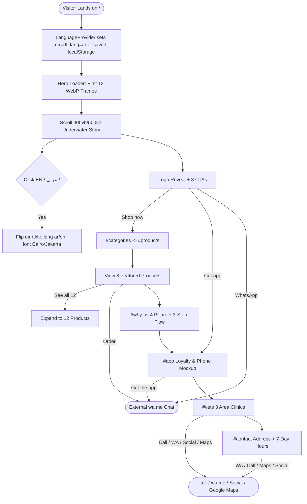

# 03 — User Flow & Interactive Controls

## 1. Visitor Journey Flowchart

## 2. Complete Inventory of Buttons & Links

*Note: Visual heights below reflect Tailwind classes (`min-h-[48px]` = 48px, `md:min-h-[56px]` = 56px, `w-12 h-12` = 48×48px).*

| Location | Label / Aria-Label | Destination / Action | Height / Size (px) |
| --- | --- | --- | --- |
| `Header.tsx` | Brand logo + `مصطفى عمار` | `#hero` | `min-h-[48px]` (48px) |
| `Header.tsx` | 5 Nav links (`#categories`..`#vets`) | Anchor scroll | `min-h-[48px]` (48px) |
| `Header.tsx` | `EN` / `عربي` | `toggleLocale()` | `min-h-[48px] min-w-[48px]` (48×48px+) |
| `Header.tsx` | `التطبيق` / `Get App` | `#app` | `min-h-[48px]` (48px) |
| `Header.tsx` | Mobile menu button | Toggle drawer | `w-12 h-12` (48×48px) |
| `HeroScrollScene.tsx` | `تصفح المتجر` / `Shop now` | `#products` | `48px` mobile / `56px` desktop |
| `HeroScrollScene.tsx` | `حمّل التطبيق` / `Get app` | `#app` | `48px` mobile / `56px` desktop |
| `HeroScrollScene.tsx` | `اطلب واتساب` / `WhatsApp` | `wa.me/201000000000` | `48px` mobile / `56px` desktop |
| `CategoriesSection.tsx` | 6 Category tiles | `#products` | Full card (`~180–220px` tall) |
| `ProductsSection.tsx` | `عرض الكل (12)` / `See all (12)` | Toggle 8 vs 12 cards | `min-h-[48px]` (48px) |
| `ProductsSection.tsx` | `اطلب` / `Order` (×8 or ×12) | `wa.me/201000000000?text=...` | `min-h-[48px]` (48px) |
| `LoyaltyAppSection.tsx` | `سجّل للتطبيق` / `Get the app` | `wa.me/201000000000?text=...` | `48px` mobile / `56px` desktop |
| `VetsSection.tsx` | `اتصال` / `Call` (×3) | `tel:+20101...` | `min-h-[48px]` (48px) |
| `VetsSection.tsx` | `واتساب` / `WhatsApp` (×3) | `wa.me/20101...` | `min-h-[48px]` (48px) |
| `VetsSection.tsx` | `الصفحة` / `Social` (×3) | `facebook.com` / `instagram.com` | `min-h-[48px]` (48px) |
| `VetsSection.tsx` | `الموقع` / `Maps` (×3) | `maps.google.com/...` | `min-h-[48px]` (48px) |
| `ContactSection.tsx` | `واتساب المتجر` / `Shop WhatsApp` | `wa.me/201000000000?text=...` | `48px` mobile / `56px` desktop |
| `ContactSection.tsx` | `اتصل بنا` / `Call Shop` | `tel:+201000000000` | `48px` mobile / `56px` desktop |
| `ContactSection.tsx` | `خريطة جوجل` / `Google Maps` | `maps.google.com/?q=Dokki,Giza,Egypt` | `48px` mobile / `56px` desktop |
| `ContactSection.tsx` | Facebook / Instagram / TikTok | External social URLs | `w-12 h-12` (48×48px) |
| `Footer.tsx` | 5 Nav links + `EN / عربي` | Anchors / `toggleLocale()` | `min-h-[48px]` (48px) |
| `MobileActionBar.tsx` | Mobile `WhatsApp` + `Call` | `wa.me/...` / `tel:...` | `min-h-[48px]` (48px, mobile `< 768px`) |
| `MobileActionBar.tsx` | Desktop floating `WhatsApp` | `wa.me/...` | `min-h-[56px]` (56px, desktop `>= 768px`) |
