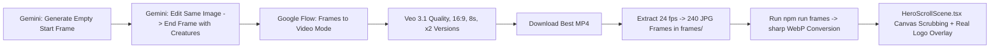

# 07 — Google Flow Video-to-Scroll Pipeline (Reusable Guide)

## 1. End-to-End Production Workflow



### Step-by-Step
1. **Start Frame (Gemini):** Generate a clean, empty underwater aquarium scene (`16:9`) with lighting, sand, rocks, driftwood, and plants — **no fish, no turtles, no logo**.
2. **End Frame (Gemini Image-to-Image):** Feed the exact Start Frame back into Gemini and instruct it to add the subjects (two green red-eared slider turtles + real aquarium fish: betta, goldfish, angelfish, swordtail, blue gourami) while keeping the background, camera angle, and lighting identical.
3. **Video Generation (Google Flow):**
   - Mode: **Frames to Video** (upload Start Frame + End Frame).
   - Model: **Veo 3.1 Quality**.
   - Aspect Ratio: **16:9**, Duration: **8 seconds**, Output count: **×2 versions**.
4. **Download & Frame Extraction:**
   - Pick the cleanest MP4 (no morphing artifacts or extra limbs).
   - Convert MP4 to numbered frames at **24 fps** (`~192–240` frames, here `240` JPGs: `ezgif-frame-001.jpg` .. `ezgif-frame-240.jpg`) into `D:\web\fish\frames\`.
5. **Optimize for Web (`npm run frames`):**
   - `scripts/prepare-frames.mjs` uses `sharp` to generate:
     - `public/frames/`: `240` WebPs (`1280×720`, quality `75`, **14.89 MB**).
     - `public/frames-mobile/`: `120` WebPs (`800×450`, quality `70`, every 2nd frame, **4.40 MB**).
6. **Code Integration (`HeroScrollScene.tsx`):**
   - Loads first 12 frames -> every 4th frame -> background pool.
   - Maps scroll progress (`400vh` mobile / `500vh` desktop) via Lenis + GSAP `ScrollTrigger` + `lerp` onto `<canvas>`.
   - Overlays the real transparent `/logo.png` and HTML CTA buttons at `87%–100%` scroll progress.

## 2. Lessons Learned
- **Match the Background Exactly:** Always generate the empty scene first, then edit that exact image to add characters for the end frame. Generating two separate images causes camera/rock/plant drift during interpolation.
- **Keep Subjects Medium-Sized & Separated:** Medium-sized fish/turtles that do not overlap rocks, plants, or each other interpolate cleanly in Veo 3.1 without warping.
- **Keep the Logo Out of the Video:** AI video generators distort text and logos. Keep the video pure scenery + creatures, and overlay the real vector/PNG logo in HTML/CSS at the finale (`87–100%`).
- **Keep Desktop Frame Folder Under 25 MB:** Stepping WebP quality to `75` (and capping mobile at half the frame count and `800px` width) keeps playback instant and bandwidth reasonable.

## 3. Prompts Used *(Paste Your Exact Prompts Below)*

### Gemini Start Frame Prompt
```text
[PASTE YOUR GEMINI START FRAME PROMPT HERE]
```

### Gemini End Frame Prompt
```text
[PASTE YOUR GEMINI END FRAME PROMPT HERE]
```

### Google Flow Prompt
```text
[PASTE YOUR GOOGLE FLOW PROMPT HERE]
```

### Google Flow Negative Prompt
```text
[PASTE YOUR GOOGLE FLOW NEGATIVE PROMPT HERE]
```

## 4. Reusable Checklist for a New Project
- [ ] Generate empty start frame (`16:9`) in Gemini with clear focal space for hero text.
- [ ] Edit start frame in Gemini to create end frame with separated, medium-sized subjects.
- [ ] Run Google Flow (**Frames to Video**, **Veo 3.1 Quality**, `16:9`, `8s`, `×2` versions).
- [ ] Extract `24 fps` numbered frames into `frames/` (verify frame 1 = empty, last frame = full scene).
- [ ] Run `npm run frames` and confirm `public/frames/` is under `25 MB`.
- [ ] Sample 5–7 real hex colors from the last frame for `tokens.css` and `MASTER.md`.
- [ ] Overlay the real transparent logo (`.webp`) and HTML CTAs in the `87–100%` scroll finale.
