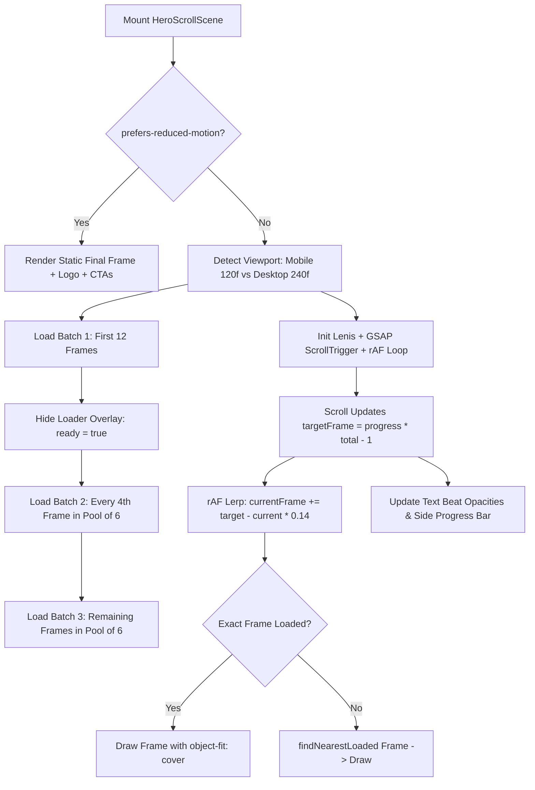
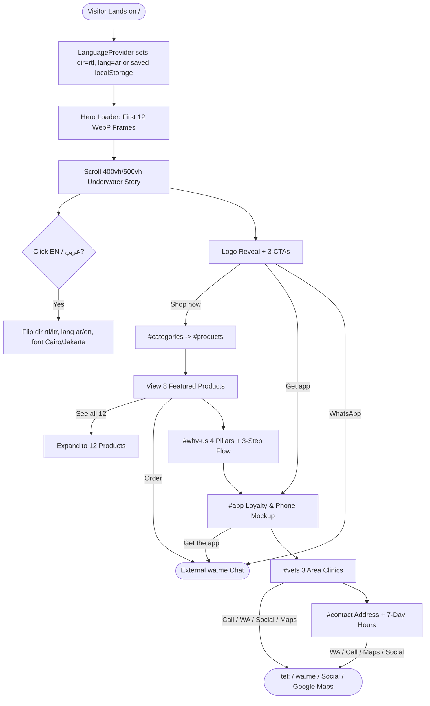
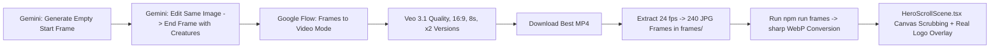

<!-- ======================================== -->
# FILE: docs/README.md
<!-- ======================================== -->

# Website Documentation Index (`docs/README.md`)

Complete read-only study, audit, and pipeline documentation for **Mostafa Ammar Aquatics** (`D:\web\fish`).

## Front End Only
- This website is **FRONT END ONLY**. There is no backend, no server, no database, no API routes, and no login.
- It builds as a pure static export (`output: "export"` in `next.config.ts`).
- All data (products, vets, contact details) lives in local files, and ordering happens through WhatsApp links (`wa.me`). Do not suggest or add any backend; all fixes and features must remain front-end-only.

## Documents
- [00-overview.md](00-overview.md) — Project summary, tech stack versions, npm scripts, deployment, and folder tree.
- [01-sitemap-and-content.md](01-sitemap-and-content.md) — Every section in order with exact Arabic/English text, word counts, images, and Lucide icons.
- [02-hero-scroll-flow.md](02-hero-scroll-flow.md) — Hero canvas mechanics, 3-batch frame loading, scroll beat timeline, reduced-motion fallback, and Mermaid diagram.
- [03-user-flow.md](03-user-flow.md) — Visitor journey Mermaid flowchart and complete inventory of buttons/links with pixel sizes.
- [04-design-system.md](04-design-system.md) — Actual colors, fonts, spacing, radii, shadows, and motion used in code vs. `MASTER.md`.
- [05-assets-and-frames.md](05-assets-and-frames.md) — Desktop/mobile WebP frame pipeline stats and full `public/` asset inventory with size flags.
- [06-audit-and-fix-list.md](06-audit-and-fix-list.md) — Laws of UX & information design audit, 16-point scorecard (`14/16`), and prioritized fix list.
- [07-flow-pipeline.md](07-flow-pipeline.md) — Reusable Google Flow (Veo 3.1) + Gemini video-to-scroll workflow, lessons learned, and prompt slots.
- [08-content-editing-guide.md](08-content-editing-guide.md) — Exact files to edit for copy, products, vets, contact info, colors, fonts, and rebuilding/deploying.

*Previous audit snapshots:* [audit-before.md](audit-before.md) | [audit-after.md](audit-after.md)

---

## Top 10 Most Important Findings

1. **Contrast Failure on Contact WhatsApp Button (HIGH):** `ContactSection.tsx` line 44 uses `bg-[#25D366]` with `text-white` (`~1.95:1` contrast, fails WCAG AA 4.5:1); all other WhatsApp buttons use `bg-[#15803D]` (`5.13:1`).
2. **Oversized `logo.png` Used Instead of `logo.webp` (HIGH):** `public/logo.png` is `892 KB` (`913,594 B`) while `public/logo.webp` (`126.6 KB`) sits unused — costing `~765 KB` on initial load.
3. **Products Section Exceeds 30-Word Budget (MEDIUM):** Shows `87` AR / `86` EN words across 8 featured cards (individual cards are short, but total section word count is > 30).
4. **Why Us & Vets Slightly Exceed 30 Words (MEDIUM):** `WhyUsSection.tsx` (`34` AR / `35` EN) and `VetsSection.tsx` (`37` AR / `37` EN) exceed 30 words due to 4 tile labels + 3-step flow and 12 clinic action buttons.
5. **Category Tiles Don't Pre-Filter Products (MEDIUM):** Clicking any tile in `CategoriesSection.tsx` jumps to `#products` without filtering or highlighting that category.
6. **Hardcoded Hex Colors Bypass `tokens.css` (MEDIUM):** Components use `#FACC15`, `#2A6CA5`, `#15803D` inline instead of `var(--color-accent)` / `var(--color-primary)`.
7. **Card Detail Copy Below 16px (LOW):** `ProductsSection.tsx`, `WhyUsSection.tsx`, and `VetsSection.tsx` use `text-sm` (`14px`) for secondary card lines instead of `text-base` (`16px`).
8. **Unused Social Icons on Disk (LOW):** `public/social/linkedin.png` (`18.2 KB`) and `public/social/search.png` (`20.1 KB`) are unused.
9. **Mock Data Still Active (CONTENT):** `lib/contact.ts`, `lib/products.ts`, `lib/vets.ts`, and `app/layout.tsx` (`metadataBase`) contain placeholder numbers, addresses, and prices.
10. **No Local Lighthouse Run (TOOLING):** Lighthouse CLI is not installed locally; performance/accessibility scores are audited via code and multi-viewport browser checks rather than automated Lighthouse JSON.

---

<!-- ======================================== -->
# FILE: docs/00-overview.md
<!-- ======================================== -->

# 00 — Project Overview

## Front End Only
- This website is **FRONT END ONLY**. There is no backend, no server, no database, no API routes, and no login.
- It builds as a pure static export (`output: "export"` in `next.config.ts`).
- All data (products, vets, contact details) lives in local TypeScript files (`lib/products.ts`, `lib/vets.ts`, `lib/contact.ts`), and ordering happens through WhatsApp links (`wa.me`).

## What the Site Is
- **Brand:** Mostafa Ammar Aquatics (`مصطفى عمار للأكواريوم`)
- **Purpose:** Static front-end showcase and WhatsApp-ordering website for an Egyptian aquatic pet shop selling ornamental fish, aquatic turtles, fish food, glass tanks, filters/pumps, water care products, and tank decor.
- **Audience:** Aquarium hobbyists and pet owners in Egypt (Arabic RTL default, English LTR switchable).
- **Ordering Model:** No cart, checkout, backend, or database; all orders and inquiries route to `wa.me` WhatsApp links or `tel:` phone links.

## Tech Stack & Versions (`package.json`)

| Package | Version | Role |
| --- | --- | --- |
| `next` | `^15.2.0` (installed `15.5.29`) | App Router + static export (`output: "export"`) |
| `react` / `react-dom` | `^19.0.0` | UI runtime |
| `typescript` | `^5.7.3` | Type safety |
| `tailwindcss` | `^4.0.9` | Utility styling via `@tailwindcss/postcss` |
| `gsap` | `^3.12.7` | `ScrollTrigger` for hero scroll progress |
| `lenis` | `^1.2.3` | Smooth wheel scrolling synced with GSAP ticker |
| `lucide-react` | `^0.475.0` | UI icon set (`strokeWidth={1.75}`) |
| `sharp` | `^0.33.5` (dev) | Image cropping and WebP frame pipeline |
| `eslint` / `eslint-config-next` | `^9.21.0` / `^15.2.0` | Linting |

## How to Run, Build & Deploy

| Command | Action |
| --- | --- |
| `npm install` | Install project dependencies locally |
| `npm run frames` | Convert `frames/*.jpg` into `public/frames/` and `public/frames-mobile/` |
| `npm run dev` | Start Next.js dev server on `http://localhost:3000` |
| `npm run lint` | Run ESLint (ignores legacy Flutter directories in `eslint.config.mjs`) |
| `npm run build` | Generate static HTML/CSS/JS export in `out/` |

### Deploy
- **Vercel / Netlify:** Connect repository, set build command to `npm run build`, and publish directory to `out`.

## Folder Tree

```text
D:\web\fish\
├── app/
│   ├── layout.tsx              # Root layout, Cairo + Plus Jakarta Sans fonts, metadata, LanguageProvider
│   ├── page.tsx                # Single-page composition: Header, Hero + 6 sections, Footer, MobileActionBar
│   └── globals.css             # Tailwind v4 import, tokens.css import, focus-visible & reduced-motion rules
├── components/
│   ├── LanguageProvider.tsx    # Arabic (ar/rtl) & English (en/ltr) state, localStorage persistence, <html> dir/lang sync
│   ├── Header.tsx              # Fixed pill navbar: logo, 5 nav links, active section highlight, EN/عربي toggle, Get App CTA
│   ├── HeroScrollScene.tsx     # 500vh/400vh pinned canvas hero, progressive WebP loader, choreographed text & logo reveal
│   ├── SectionReveal.tsx       # IntersectionObserver fade-up wrapper (transform + opacity)
│   ├── MobileActionBar.tsx     # Mobile sticky bottom WhatsApp + Call bar; desktop floating WhatsApp button
│   ├── Footer.tsx              # Brand logo, 5 nav links, language toggle, copyright
│   └── sections/
│       ├── CategoriesSection.tsx  # 6 category cards with cropped WebP images + Lucide icons
│       ├── ProductsSection.tsx    # 8 featured products (expandable to 12) with 1 Best Seller highlight
│       ├── WhyUsSection.tsx       # 4 trust tiles + 2-line caption + 3-step Buy/Reminded/Reorder flow
│       ├── LoyaltyAppSection.tsx  # Bronze/Silver/Gold tier bar + CSS phone mockup + Get App CTA
│       ├── VetsSection.tsx        # 3 area-grouped vet contact cards (Call, WhatsApp, Social, Maps)
│       └── ContactSection.tsx     # Shop address, WhatsApp/Call/Maps CTAs, Facebook/IG/TikTok, 7-day hours strip
├── lib/
│   ├── i18n.ts                 # Complete Arabic & English UI dictionary
│   ├── products.ts             # 6 categories & 12 products (EGP prices, images, WhatsApp message builder)
│   ├── vets.ts                 # 3 mock vet clinic records
│   └── contact.ts              # Shop phone, WhatsApp, address, social URLs, 7-day schedule
├── scripts/
│   └── prepare-frames.mjs      # sharp script generating desktop/mobile WebP frames + manifest.json + logo.webp
├── design-system/fishshop/
│   ├── MASTER.md               # Persisted design system specification
│   └── tokens.css              # 3-layer CSS custom properties (primitive -> semantic -> component)
├── public/
│   ├── frames/                 # 240 desktop WebP frames (1280x720) + manifest.json
│   ├── frames-mobile/          # 120 mobile WebP frames (800x450) + manifest.json
│   ├── images/                 # 7 cropped WebP creature/aquascape tiles from frame_240.webp
│   ├── social/                 # 6 brand PNG icons (whatsapp, facebook, instagram, tik-tok, linkedin, search)
│   ├── logo.png                # Transparent shop logo (892 KB, currently used in UI)
│   └── logo.webp               # WebP version of shop logo (126 KB, currently unused in UI)
├── frames/                     # Original 240 source JPGs (untouched)
├── next.config.ts              # output: "export", images: { unoptimized: true }
├── eslint.config.mjs           # ESLint flat config ignoring out/, .next/, scripts/, and legacy Flutter folders
└── docs/                       # Documentation and audit files
```

---

<!-- ======================================== -->
# FILE: docs/01-sitemap-and-content.md
<!-- ======================================== -->

# 01 — Sitemap & Content Inventory

The site is a single-page application (`app/page.tsx`) with 7 main bands (`Hero` + 6 content sections), plus `Header`, `Footer`, and `MobileActionBar`.

---

## 1. Header (`components/Header.tsx`)
- **Purpose:** Brand anchor, 5-link section navigation, language toggle, mobile menu drawer.
- **Visible Text (AR / EN):**
  - Brand: `مصطفى عمار` / `Mostafa Ammar`
  - Nav links: `الأقسام` / `Categories`, `المنتجات` / `Products`, `لماذا نحن` / `Why Us`, `التطبيق` / `App`, `الأطباء` / `Vets`
  - Language button: `EN` (when AR) / `عربي` (when EN)
  - CTA button: `التطبيق` / `Get App`
- **Images & Icons:** `/logo.png`, Lucide `Globe`, `ArrowRight` (`rtl:rotate-180`), `Smartphone`, `Menu`, `X`.

---

## 2. Hero (`#hero` — `components/HeroScrollScene.tsx`)
- **Purpose:** Scroll-driven underwater story ending with logo reveal and primary CTAs.
- **Word Count:** `25` words (AR) / `29` words (EN)
- **Visible Text:**

| Element | Arabic | English |
| --- | --- | --- |
| Eyebrow | `مصطفى عمار للأكواريوم` | `Mostafa Ammar Aquatics` |
| H1 Headline | `سمكتك. عالمك.` | `Your fish. Your world.` |
| Feature 1 | `أسماك وسلاحف بصحة ممتازة` | `Healthy fish selected with care` |
| Feature 2 | `أغذية وفلاتر وأحواض متكاملة` | `Food, filters, and complete tanks` |
| Feature 3 | `توصيل آمن للأسماك الحية` | `Safe oxygenated live fish delivery` |
| Primary CTA | `تصفح المتجر` | `Shop now` |
| Secondary CTA 1 | `حمّل التطبيق` | `Get app` |
| Secondary CTA 2 | `اطلب واتساب` | `WhatsApp` |
| Scroll Hint | `مرر للأسفل` | `Scroll down` |
| Loader | `جاري تجهيز الحوض...` | `Preparing the tank...` |

- **Images & Icons:** Canvas frames (`/frames/frame_001.webp`..`240` or `/frames-mobile/frame_001.webp`..`120`), `/logo.png`, `/social/whatsapp.png`, Lucide `ShoppingBag`, `Smartphone`, `ChevronDown`.

---

## 3. Categories (`#categories` — `components/sections/CategoriesSection.tsx`)
- **Purpose:** 6 visual category tiles linking to `#products`.
- **Word Count:** `20` words (AR) / `23` words (EN)
- **Heading & Subtitle:** `الأقسام` / `Categories` — `كل ما يحتاجه حوضك في 6 أقسام` / `Everything your tank needs in 6 categories`
- **Tiles (6):**

| Category ID | Arabic Title | English Title | Image Path | Lucide Icon |
| --- | --- | --- | --- | --- |
| `fish` | `أسماك وسلاحف` | `Fish & Turtles` | `/images/betta.webp` | `Fish` |
| `food` | `أغذية الأسماك` | `Fish Food` | `/images/goldfish.webp` | `Utensils` |
| `tanks` | `أحواض زجاجية` | `Glass Tanks` | `/images/aquascape.webp` | `Box` |
| `filters` | `فلاتر ومضخات` | `Filters & Pumps` | `/images/gourami.webp` | `Waves` |
| `care` | `عناية بالمياه` | `Water Care` | `/images/angelfish.webp` | `Droplets` |
| `decor` | `ديكور ونباتات` | `Decor & Plants` | `/images/swordtail.webp` | `Leaf` |

---

## 4. Featured Products (`#products` — `components/sections/ProductsSection.tsx`)
- **Purpose:** Display 8 featured products (expandable to 12 via `عرض الكل (12)` / `See all (12)`) with direct WhatsApp ordering.
- **Word Count:** `87` words (AR) / `86` words (EN) when showing 8 featured items.
- **Heading & Controls:** `الأكثر طلباً` / `Featured Products` | Toggle: `عرض الكل (12)` / `See all (12)` <-> `عرض أقل` / `Show less` | Badge: `الأكثر مبيعاً` / `Best seller` | Button: `اطلب` / `Order`

| ID | Arabic Name & Detail | English Name & Detail | Price (EGP) | Image | Featured |
| --- | --- | --- | ---: | --- | --- |
| `prod-1` | `سمكة بيتا هاف مون` — `ألوان زاهية وصحة ممتازة` | `Halfmoon Betta Fish` — `Vibrant fins, health checked` | 220 | `/images/betta.webp` | Yes (Best seller) |
| `prod-2` | `سلحفاة مائية خضراء` — `درع قوي ونشاط عالي` | `Green Aquatic Turtle` — `Strong shell, active` | 350 | `/images/turtle.webp` | Yes |
| `prod-3` | `زوج أنجل فيش` — `هادئ ومناسب للأحواض المزروعة` | `Striped Angelfish Pair` — `Peaceful tank companions` | 280 | `/images/angelfish.webp` | Yes |
| `prod-4` | `أكل تيترا للألوان` — `يقوي المناعة بدون تعكير` | `Tropical Color Flakes` — `Clean water vitamin flakes` | 195 | `/images/goldfish.webp` | Yes |
| `prod-5` | `وجبة سلاحف بالكالسيوم` — `أعواد طافية لنمو الدرع` | `Calcium Turtle Sticks` — `Floating shell nutrition` | 160 | `/images/turtle.webp` | No |
| `prod-6` | `حوض زجاجي 60 سم` — `زجاج نقي بإضاءة LED` | `60cm LED Glass Tank` — `Clear glass + LED hood` | 1850 | `/images/aquascape.webp` | Yes |
| `prod-7` | `حوض نانو 25 لتر` — `زوايا دائرية وفلتر مدمج` | `25L Desktop Nano Tank` — `Curved glass, built-in filter` | 1150 | `/images/gourami.webp` | No |
| `prod-8` | `فلتر شلال هادئ` — `ترشيح ثلاثي بدون صوت` | `Quiet Waterfall Filter` — `Silent 3-stage filtration` | 460 | `/images/gourami.webp` | Yes |
| `prod-9` | `مضخة هواء مزدوجة` — `أكسجين مستقر للحوض` | `Dual Air Pump Kit` — `Steady tank oxygenation` | 290 | `/images/swordtail.webp` | No |
| `prod-10` | `مزيل كلور فوري` — `يحمي السمك فوراً` | `Instant Water Conditioner` — `Safe tap water instantly` | 140 | `/images/angelfish.webp` | Yes |
| `prod-11` | `بكتيريا نافعة للحوض` — `توازن سريع للمياه الجديدة` | `Live Tank Bacteria` — `Fast nitrogen cycle starter` | 210 | `/images/betta.webp` | No |
| `prod-12` | `خشب طبيعي مع أنوبياس` — `مخبأ طبيعي وتنقية للمياه` | `Driftwood + Live Anubias` — `Natural shelter & live plant` | 320 | `/images/aquascape.webp` | Yes |

- **Images & Icons:** Product images above, `/social/whatsapp.png`, Lucide `Star`, `ArrowDown`, `ArrowUp`.

---

## 5. Why Us (`#why-us` — `components/sections/WhyUsSection.tsx`)
- **Purpose:** Trust pillars (merged About story) + 3-step feeding reminder flow.
- **Word Count:** `34` words (AR) / `35` words (EN)
- **Heading & Caption:** `لماذا نحن` / `Why Us` — `نختار كل سمكة بعناية ونفحصها صحياً قبل التسليم.` / `Every fish is hand-picked and health-checked before delivery.`
- **4 Tiles:**
  1. `فحص صحي` (`قبل كل تسليم`) / `Health Check` (`Before every delivery`) — `HeartPulse`
  2. `توصيل آمن` (`أكسجين كامل`) / `Safe Delivery` (`Full oxygen pack`) — `Truck`
  3. `نقاط ولاء` (`مع كل طلب`) / `Loyalty Points` (`Earn every order`) — `Award`
  4. `أطباء موثوقون` (`رعاية فورية`) / `Trusted Vets` (`Fast expert care`) — `Stethoscope`
- **3-Step Flow:** `تذكير الأكل`: `اشترِ` → `تنبيه` → `أعد الطلب` / `Food reminder`: `Buy` → `Reminded` → `Reorder` (`ShoppingBag`, `BellRing`, `RefreshCw`, `ArrowRight`).

---

## 6. App & Loyalty (`#app` — `components/sections/LoyaltyAppSection.tsx`)
- **Purpose:** Present loyalty tiers and mobile app preview.
- **Word Count:** `27` words (AR) / `30` words (EN)
- **Heading & Subtitle:** `التطبيق والولاء` / `App & Loyalty` — `اجمع النقاط وتابع مواعيد الإطعام` / `Collect points and track feeding times`
- **Tier Bar:** `برونزية` / `Bronze`, `فضية` / `Silver`, `ذهبية` / `Gold` (highlighted)
- **CTAs:** `سجّل للتطبيق` / `Get the app`, badge `قريباً iOS و Android` / `Coming soon iOS & Android`
- **Phone Mockup:** `نادي مصطفى عمار` / `Mostafa Ammar Club`, `ذهبية` / `Gold`, `1,250 نقطة` / `1,250 pts`, `موعد الأكل • 7:00 م` / `Feeding • 7:00 PM`
- **Images & Icons:** `/logo.png`, Lucide `Award`, `Smartphone`, `Sparkles`, `Bell`.

---

## 7. Trusted Vets (`#vets` — `components/sections/VetsSection.tsx`)
- **Purpose:** 3 area-grouped aquatic vet contacts.
- **Word Count:** `37` words (AR) / `37` words (EN)
- **Heading:** `أطباء موثوقون` / `Trusted Vets`
- **Cards:**
  1. `المهندسين` / `Mohandessin` — `د. أحمد الشربيني` / `Dr. Ahmed El-Sherbiny` — `أمراض أسماك الزينة` / `Ornamental fish care`
  2. `المعادي` / `Maadi` — `د. سلمى عبد الرحمن` / `Dr. Salma Abdelrahman` — `رعاية السلاحف المائية` / `Aquatic turtle specialist`
  3. `مدينة نصر` / `Nasr City` — `د. كريم منصور` / `Dr. Karim Mansour` — `تغذية وعلاج الأسماك` / `Fish nutrition & treatment`
- **Buttons per card:** `اتصال` / `Call`, `واتساب` / `WhatsApp`, `الصفحة` / `Social`, `الموقع` / `Maps`
- **Images & Icons:** `/social/whatsapp.png`, Lucide `MapPin`, `Stethoscope`, `Phone`, `Share2`.

---

## 8. Contact & Location (`#contact` — `components/sections/ContactSection.tsx`)
- **Purpose:** Direct shop contact, location, social channels, and visual 7-day hours strip.
- **Word Count:** `14` words (AR) / `16` words (EN) (plus 7 day/hour cells)
- **Heading & Address:** `زُرنا وتواصل` / `Visit & Contact` — `شارع التحرير، الدقي، الجيزة` / `El Tahrir St., Dokki, Giza`
- **Buttons:** `واتساب المتجر` / `Shop WhatsApp`, `اتصل بنا` / `Call Shop`, `خريطة جوجل` / `Google Maps`
- **Hours Title:** `مواعيد العمل` / `Opening Hours` (`السبت`–`الخميس` `11ص-11م`, `الجمعة` `2م-11م` / `Sat`–`Thu` `11-11`, `Fri` `2-11`)
- **Images & Icons:** `/social/whatsapp.png`, `/social/facebook.png`, `/social/instagram.png`, `/social/tik-tok.png`, Lucide `MapPin`, `Phone`, `Clock`.

---

## 9. Footer & Mobile Action Bar (`Footer.tsx`, `MobileActionBar.tsx`)
- **Footer:** `/logo.png`, 5 nav links, `EN / عربي` toggle, `مصطفى عمار للأكواريوم © 2026` / `Mostafa Ammar Aquatics © 2026`.
- **Mobile Sticky Bar (`< 768px`):** `واتساب` / `WhatsApp` (`/social/whatsapp.png`) + `اتصال` / `Call` (Lucide `Phone`).
- **Desktop Floating Button (`>= 768px`):** `واتساب` / `WhatsApp` (`/social/whatsapp.png`) at `bottom-6 end-6`.

---

<!-- ======================================== -->
# FILE: docs/02-hero-scroll-flow.md
<!-- ======================================== -->

# 02 — Hero Scroll Flow (`components/HeroScrollScene.tsx`)

## 1. Canvas & Viewport Architecture
- **Outer Scroll Track:** `h-[400vh]` on mobile (`< 768px`) and `md:h-[500vh]` on desktop (`>= 768px`).
- **Sticky Stage:** `sticky top-0 h-[100dvh] w-full overflow-hidden bg-[#378FC8]`.
- **Canvas Rendering:**
  - `getContext("2d", { alpha: false })`.
  - `resizeCanvas()` sets `canvas.width = rect.width * dpr` and `canvas.height = rect.height * dpr` where `dpr = Math.min(window.devicePixelRatio || 1, 2)`.
  - `drawCover(img)` computes `scale = Math.max(cw / iw, ch / ih)` to replicate `object-fit: cover` centered.
- **Scroll & Smoothing:**
  - `Lenis` (`duration: 1.15`, exponential ease-out) syncs with GSAP via `lenis.on("scroll", ScrollTrigger.update)` and `gsap.ticker.add(...)` with `gsap.ticker.lagSmoothing(0)`.
  - `ScrollTrigger.create({ trigger: containerRef.current, start: "top top", end: "bottom bottom", scrub: true })` maps scroll progress `p` (`0..1`) to `targetFrameRef.current = p * (total - 1)`.
  - `requestAnimationFrame` loop interpolates `currentFrameRef.current += (targetFrameRef.current - currentFrameRef.current) * 0.14` and draws only when `Math.round(currentFrameRef.current) !== lastDrawnIndexRef.current`.

## 2. Progressive Frame Loading
- **Desktop (`>= 768px`):** `240` frames from `/frames/frame_001.webp` .. `frame_240.webp`.
- **Mobile (`< 768px`):** `120` frames from `/frames-mobile/frame_001.webp` .. `frame_120.webp`.
- **3-Batch Strategy:**
  1. **Batch 1 (Blocking Loader):** First `12` frames (`0..11`). Updates `loadPercent` (`0..100%`). Once complete, `setReady(true)` hides the loader.
  2. **Batch 2 (Scrubbing Skeleton):** Every 4th frame (`12, 16, 20...`) loaded via a 6-worker concurrency pool.
  3. **Batch 3 (Background Fill):** Remaining frames loaded via a 6-worker pool.
- **Fallback:** `findNearestLoaded(targetIdx)` searches outward (`±offset`) so scrolling never blocks or flickers on unloaded frames.

## 3. Scroll Beat Timeline (`progress` `0.00` to `1.00`)

| Progress Range | What Appears | Animation Type | RTL (`ar`) vs LTR (`en`) Direction |
| --- | --- | --- | --- |
| `0% – 7%` | Scroll hint pill (`مرر للأسفل` / `Scroll down`) | Fade out (`1 -> 0`) | Centered bottom |
| `0% – 16%` (peak `0–10%`) | Eyebrow + `<h1>` (`سمكتك. عالمك.` / `Your fish. Your world.`) | Fade + vertical rise (`18px -> 0px`) | Centered |
| `16% – 40%` (peak `21–34%`) | Feature 1 (`أسماك وسلاحف بصحة ممتازة`) | Fade + horizontal slide (`48px -> 0px`) | RTL: slides from right (`+48px`); LTR: from left (`-48px`) |
| `40% – 64%` (peak `45–58%`) | Feature 2 (`أغذية وفلاتر وأحواض متكاملة`) | Fade + opposite horizontal slide | RTL: slides from left (`-48px`); LTR: from right (`+48px`) |
| `64% – 87%` (peak `69–81%`) | Feature 3 (`توصيل آمن للأسماك الحية`) | Fade + soft scale (`0.90 -> 1.00`) | Centered bottom |
| `87% – 100%` | Logo reveal (`/logo.png`) + `<h2>` + 3 CTAs (`Shop now`, `Get app`, `WhatsApp`) | Fade + scale (`0.92 -> 1.00`) + sunlit glow | Centered; `pointer-events-auto` when `finaleOpacity > 0.2` |

## 4. Reduced Motion Fallback (`prefers-reduced-motion: reduce`)
- Skips `Lenis`, `ScrollTrigger`, `400vh/500vh` pinning, and progressive frame loading.
- Renders a static `min-h-[100dvh]` section with the final frame (`/frames/frame_240.webp` on desktop, `/frames-mobile/frame_120.webp` on mobile), royal-blue gradient scrim, `/logo.png`, eyebrow, `<h1>`, all 3 feature lines, and all 3 CTA buttons visible immediately.

## 5. Load & Scroll Logic Flowchart



---

<!-- ======================================== -->
# FILE: docs/03-user-flow.md
<!-- ======================================== -->

# 03 — User Flow & Interactive Controls

## 1. Visitor Journey Flowchart



## 2. Complete Inventory of Buttons & Links

*Note: Visual heights below reflect Tailwind classes (`min-h-[48px]` = 48px, `md:min-h-[56px]` = 56px, `w-12 h-12` = 48×48px).*

| Location | Label / Aria-Label | Destination / Action | Height / Size (px) |
| --- | --- | --- | --- |
| `Header.tsx` | Brand logo + `مصطفى عمار` | `#hero` | `min-h-[48px]` (48px) |
| `Header.tsx` | 5 Nav links (`#categories`..`#vets`) | Anchor scroll | `min-h-[48px]` (48px) |
| `Header.tsx` | `EN` / `عربي` | `toggleLocale()` | `min-h-[48px] min-w-[48px]` (48×48px+) |
| `Header.tsx` | `التطبيق` / `Get App` | `#app` | `min-h-[48px]` (48px) |
| `Header.tsx` | Mobile menu button | Toggle drawer | `w-12 h-12` (48×48px) |
| `HeroScrollScene.tsx` | `تصفح المتجر` / `Shop now` | `#products` | `48px` mobile / `56px` desktop |
| `HeroScrollScene.tsx` | `حمّل التطبيق` / `Get app` | `#app` | `48px` mobile / `56px` desktop |
| `HeroScrollScene.tsx` | `اطلب واتساب` / `WhatsApp` | `wa.me/201000000000` | `48px` mobile / `56px` desktop |
| `CategoriesSection.tsx` | 6 Category tiles | `#products` | Full card (`~180–220px` tall) |
| `ProductsSection.tsx` | `عرض الكل (12)` / `See all (12)` | Toggle 8 vs 12 cards | `min-h-[48px]` (48px) |
| `ProductsSection.tsx` | `اطلب` / `Order` (×8 or ×12) | `wa.me/201000000000?text=...` | `min-h-[48px]` (48px) |
| `LoyaltyAppSection.tsx` | `سجّل للتطبيق` / `Get the app` | `wa.me/201000000000?text=...` | `48px` mobile / `56px` desktop |
| `VetsSection.tsx` | `اتصال` / `Call` (×3) | `tel:+20101...` | `min-h-[48px]` (48px) |
| `VetsSection.tsx` | `واتساب` / `WhatsApp` (×3) | `wa.me/20101...` | `min-h-[48px]` (48px) |
| `VetsSection.tsx` | `الصفحة` / `Social` (×3) | `facebook.com` / `instagram.com` | `min-h-[48px]` (48px) |
| `VetsSection.tsx` | `الموقع` / `Maps` (×3) | `maps.google.com/...` | `min-h-[48px]` (48px) |
| `ContactSection.tsx` | `واتساب المتجر` / `Shop WhatsApp` | `wa.me/201000000000?text=...` | `48px` mobile / `56px` desktop |
| `ContactSection.tsx` | `اتصل بنا` / `Call Shop` | `tel:+201000000000` | `48px` mobile / `56px` desktop |
| `ContactSection.tsx` | `خريطة جوجل` / `Google Maps` | `maps.google.com/?q=Dokki,Giza,Egypt` | `48px` mobile / `56px` desktop |
| `ContactSection.tsx` | Facebook / Instagram / TikTok | External social URLs | `w-12 h-12` (48×48px) |
| `Footer.tsx` | 5 Nav links + `EN / عربي` | Anchors / `toggleLocale()` | `min-h-[48px]` (48px) |
| `MobileActionBar.tsx` | Mobile `WhatsApp` + `Call` | `wa.me/...` / `tel:...` | `min-h-[48px]` (48px, mobile `< 768px`) |
| `MobileActionBar.tsx` | Desktop floating `WhatsApp` | `wa.me/...` | `min-h-[56px]` (56px, desktop `>= 768px`) |

---

<!-- ======================================== -->
# FILE: docs/04-design-system.md
<!-- ======================================== -->

# 04 — Design System (Code vs. `MASTER.md`)

## 1. Colors Actually Used in Code (`design-system/fishshop/tokens.css` & components)

| Token / Role | Actual Hex / RGBA in Code | Where Used |
| --- | --- | --- |
| Horizon Royal Blue (`--ocean-royal-blue`) | `#2A6CA5` | Footer bg, active nav pill, prices, flow icons, Loyalty card gradient |
| Deep Water Blue (`--ocean-deep-blue`) | `#378FC8` | Hero canvas fallback bg, App section gradient |
| Center Water Cyan (`--ocean-center-cyan`) | `#45ACD4` | Hero loader gradient, image tile tint (`#45ACD4/15`, `#45ACD4/20`) |
| Bright Mid-Water Cyan (`--ocean-mid-cyan`) | `#5ECAE2` | Hero Feature 2 accent bar, Hero eyebrow pill (`#5ECAE2/25`) |
| Sunlit Top Cyan (`--ocean-sunlit-cyan`) | `#BFE9DA` | Hero glass borders (`#BFE9DA/35..50`), logo drop-shadow |
| Royal Scrim (`--ocean-royal-scrim`) | `#1B5183` / `rgba(27,81,131,0.78)` | Hero glass panels, unscrolled header pill, mobile drawer |
| Sunny Yellow CTA (`--ocean-cta-yellow`) | `#FACC15` (hover `#EAB308`) | Primary CTAs, Best Seller card frame, Gold loyalty tier, focus ring |
| Deep Navy Ink (`--ocean-navy-ink`) | `#071A2F` | Headings, body text, CTA text on yellow, phone mockup frame |
| Slate Ink (`--ocean-slate-ink`) | `#334155` | Card details, subtitles, week strip hours |
| Page Ice Background (`--ocean-surface-ice`) | `#F0F9FF` | Body bg, scrolled header (`#F0F9FF/94`), inner tiles |
| Muted Ice (`--ocean-surface-muted`) | `#E0F2FE` | Double-bezel outer shells, icon containers, Call buttons |
| Light Border (`--ocean-border-light`) | `#BAE6FD` | Card & tile borders |
| WhatsApp Green (Hardcoded) | `#15803D` (hover `#166534`), `#25D366` (ContactSection) | WhatsApp buttons |

## 2. Typography (`app/layout.tsx`, `LanguageProvider.tsx`)
- **Arabic (`dir="rtl"`):** `Cairo` (weights `400, 500, 600, 700, 800`), CSS var `--font-cairo`.
- **English (`dir="ltr"`):** `Plus Jakarta Sans` (weights `400, 500, 600, 700, 800`), CSS var `--font-jakarta`.
- **Type Scale in Code:**
  - `h1` (Hero): `text-4xl sm:text-6xl md:text-7xl font-extrabold` (`36px` -> `60px` -> `72px`)
  - `h2` (Sections): `text-3xl sm:text-4xl font-extrabold` (`30px` -> `36px`; `48px` in App section)
  - `h3` (Cards): `text-base sm:text-lg font-extrabold` (`16px` -> `18px`)
  - Body / Buttons: `text-sm` (`14px`) to `text-base` (`16px`)

## 3. Spacing, Radius, Shadows & Motion
- **Section Padding:** `py-20 sm:py-24 px-4 sm:px-6 lg:px-8` (`80px` / `96px` vertical)
- **Card Radii:** Outer shell `rounded-[1.5rem]` to `rounded-[2.25rem]`, inner core `rounded-[calc(...-0.375rem)]`, buttons `rounded-full` or `rounded-xl`.
- **Shadows:** Soft ocean-tinted (`rgba(42,108,165,0.12)` on scrolled header, `rgba(250,204,21,0.28)` on Best Seller card, `rgba(27,81,131,0.28)` on Hero glass).
- **Icon Set:** `lucide-react` (`strokeWidth={1.75}` everywhere) + PNG brand icons in `public/social/`.
- **Motion (`SectionReveal.tsx`, `Header.tsx`):** `cubic-bezier(0.32, 0.72, 0, 1)`, `200ms–520ms`, GPU-only (`transform`, `opacity`), `@media (hover: hover)` hover gating, `prefers-reduced-motion` honored in `globals.css` and `HeroScrollScene.tsx`.

## 4. Differences Between Code & `design-system/fishshop/MASTER.md`

| Item | `MASTER.md` Spec | Actual Code |
| --- | --- | --- |
| Primary Button Color | `--color-accent` (`#EA580C` / `#FACC15`) | Uses hardcoded hex `#FACC15` and `#2A6CA5` instead of `var(--color-accent)` / `var(--color-primary)`. |
| WhatsApp Button Green | Not defined in `tokens.css` | Hardcoded `#15803D` in Hero/Products/Vets/MobileBar vs `#25D366` in `ContactSection.tsx` (inconsistent). |
| Typography Tokens | `--font-heading` / `--font-body` | `LanguageProvider.tsx` sets `document.body.style.fontFamily` directly to `var(--font-cairo)` or `var(--font-jakarta)`. |
| Icon Set | Single SVG icon set | Mixes `lucide-react` SVGs with raster PNGs (`public/social/*.png`). |
| Component Classes | `.btn-primary`, `.card` in `MASTER.md` | Tailwind utility classes inline on JSX; `MASTER.md` CSS classes are unused. |

---

<!-- ======================================== -->
# FILE: docs/05-assets-and-frames.md
<!-- ======================================== -->

# 05 — Assets & Frame Pipeline

## 1. Frame Pipeline (`scripts/prepare-frames.mjs`)
- **Command:** `npm run frames`
- **Source Folder:** `D:\web\fish\frames` (`240` JPGs: `ezgif-frame-001.jpg` .. `ezgif-frame-240.jpg`, untouched)
- **Desktop Output (`public/frames/`):**
  - `240` WebP files (`frame_001.webp` .. `frame_240.webp`)
  - Dimensions: `1280×720` (`withoutEnlargement: true`), quality `75`
  - Total Size: **14.89 MB** (`15,609,498` bytes + `manifest.json`)
- **Mobile Output (`public/frames-mobile/`):**
  - `120` WebP files (`frame_001.webp` .. `frame_120.webp`, every 2nd frame)
  - Dimensions: `800×450`, quality `70`
  - Total Size: **4.40 MB** (`4,611,928` bytes + `manifest.json`)

## 2. Complete `public/` Asset Inventory

| Asset Path | Size | Where Used | Status / Flag |
| --- | ---: | --- | --- |
| `public/frames/` (240 + manifest) | 14.89 MB | `HeroScrollScene.tsx` (desktop `>= 768px`) | OK (under 25 MB) |
| `public/frames-mobile/` (120 + manifest) | 4.40 MB | `HeroScrollScene.tsx` (mobile `< 768px`) | OK |
| `public/logo.png` | **913,594 B (892 KB)** | `layout.tsx`, `Header.tsx`, `HeroScrollScene.tsx`, `LoyaltyAppSection.tsx`, `Footer.tsx` | **FLAG: Oversized** (use `logo.webp` instead) |
| `public/logo.webp` | 129,654 B (126.6 KB) | **Unused in UI components** | **FLAG: Unused** (85% smaller than `logo.png`) |
| `public/images/turtle.webp` | 10,014 B | `products.ts` (`prod-2`, `prod-5`) | OK |
| `public/images/betta.webp` | 11,174 B | `CategoriesSection`, `products.ts` (`prod-1`, `prod-11`) | OK |
| `public/images/angelfish.webp` | 11,180 B | `CategoriesSection`, `products.ts` (`prod-3`, `prod-10`) | OK |
| `public/images/goldfish.webp` | 14,314 B | `CategoriesSection`, `products.ts` (`prod-4`) | OK |
| `public/images/gourami.webp` | 14,772 B | `CategoriesSection`, `products.ts` (`prod-7`, `prod-8`) | OK |
| `public/images/swordtail.webp` | 15,660 B | `CategoriesSection`, `products.ts` (`prod-9`) | OK |
| `public/images/aquascape.webp` | 22,484 B | `CategoriesSection`, `products.ts` (`prod-6`, `prod-12`) | OK |
| `public/social/whatsapp.png` | 28,478 B | `HeroScrollScene`, `ProductsSection`, `VetsSection`, `ContactSection`, `MobileActionBar` | OK |
| `public/social/facebook.png` | 16,039 B | `ContactSection.tsx` | OK |
| `public/social/instagram.png` | 42,247 B | `ContactSection.tsx` | OK |
| `public/social/tik-tok.png` | 25,374 B | `ContactSection.tsx` | OK |
| `public/social/linkedin.png` | 18,212 B | **Unused** (removed per user request) | **FLAG: Unused file** |
| `public/social/search.png` | 20,103 B | **Unused** (replaced by `MapPin` icon) | **FLAG: Unused file** |
| **Total `public/`** | **20.52 MB (21,515,288 B)** | 377 files | — |

---

<!-- ======================================== -->
# FILE: docs/06-audit-and-fix-list.md
<!-- ======================================== -->

# 06 — Full Audit & Prioritized Fix List

## 1. Audit Against Laws of UX & Information Design

| Principle | Status | Evidence (File & Section) | Fix |
| --- | --- | --- | --- |
| **Hick's Law** | **Pass** | `Header.tsx` has 5 nav links; `ProductsSection.tsx` shows 8 featured items + `See all (12)`; 1 yellow CTA per screen. | — |
| **Fitts's Law** | **Pass** | All buttons/links `min-h-[48px]` mobile / `md:min-h-[56px]` desktop; `>= 8px` gaps; `MobileActionBar.tsx` sticky thumb bar. | — |
| **Miller's Law** | **Pass** | 5 nav links, 6 categories, 4 Why Us tiles, 3 tiers, 3 vets (7-day week strip is standard calendar). | — |
| **Von Restorff** | **Pass** | Single yellow `"Best seller"` card (`ProductsSection.tsx`), single `"Gold"` tier (`LoyaltyAppSection.tsx`). | — |
| **Jakob's Law** | **Pass** | Logo at start side (`Header.tsx`), standard footer, Phone/WhatsApp icons. | — |
| **Aesthetic-Usability & Doherty** | **Pass** | Cropped creature WebPs, double-bezel cards, `200ms` press/hover feedback (`active:scale-[0.97]`). | — |
| **Information Design & LATCH** | **Partial** | Categories (Category), Products (Hierarchy), Vets (Location), Hours (Time) applied; clicking a Category tile scrolls to `#products` without pre-selecting that category. | Pass selected category state or `#products` anchor filter if desired. |
| **Affordance & Signifiers** | **Pass** | Pill buttons with shadows, `rtl:rotate-180` arrows, active section pill in `Header.tsx`. | — |
| **Accessibility & Universal Design** | **Partial** | `focus-visible` ring, `aria-hidden` on decorative icons, `>= 4.5:1` contrast. However, `text-sm` (`14px`) is used on card details/nav/vet buttons instead of `>= 16px`, and `ContactSection.tsx` uses `#25D366` with white text (contrast ~1.95:1 — **FAIL**!). | Change `#25D366` to `#15803D` (`5.1:1` with white) and bump card detail text to `text-base` (`16px`). |

## 2. Specific Technical & Content Findings
- **Contrast Problem (HIGH):** `ContactSection.tsx` line 44 uses `bg-[#25D366]` with `text-white` (`~1.95:1` contrast ratio, fails WCAG AA 4.5:1). Every other WhatsApp button uses `bg-[#15803D]` (`5.13:1`).
- **Oversized Logo Asset (HIGH):** `public/logo.png` (`892 KB`) is loaded in `Header.tsx`, `HeroScrollScene.tsx`, `LoyaltyAppSection.tsx`, `Footer.tsx`, and `layout.tsx`, while `public/logo.webp` (`126.6 KB`, 85% smaller) sits unused.
- **Unused Files in `public/social/` (LOW):** `linkedin.png` and `search.png` remain on disk unused.
- **Hardcoded Tailwind Hexes vs. Tokens (MEDIUM):** Components use `#FACC15`, `#2A6CA5`, `#15803D` directly instead of CSS variables from `tokens.css`.
- **Body Text Under 16px in Cards (LOW):** Card descriptions (`ProductsSection.tsx` line 86, `WhyUsSection.tsx` line 44, `VetsSection.tsx` line 44) use `text-sm` (`14px`).
- **Hero Loader Uses `ready` Before Decoding (LOW):** `HeroScrollScene.tsx` sets `ready = true` on `img.onload`, which is fast, though `img.decode()` could prevent first-paint jank on slow phones.
- **Lighthouse:** Not run (Lighthouse CLI not installed locally).

## 3. 16-Point Scorecard

| # | Criterion | Yes / No | Evidence |
| --- | --- | --- | --- |
| 1 | Each section has fewer than 30 words | **No** | Hero (25/29), Categories (20/23), App (27/30), Contact (14/16) pass; Products (87/86), Why Us (34/35), Vets (37) exceed 30. |
| 2 | Every card has an icon or image | **Yes** | All 6 category & 12 product cards have WebPs; Why Us, App, Vets, Contact cards have Lucide icons. |
| 3 | No paragraph is longer than 2 lines | **Yes** | Only `WhyUsSection.tsx` has a 1-sentence `line-clamp-2` caption. |
| 4 | Clear heading hierarchy (`h1` -> `h2` -> `h3`) | **Yes** | 1 `<h1>` in Hero, `<h2>` per section, `<h3>` per card. |
| 5 | 6 sections or fewer in main flow | **Yes** | 6 sections below Hero, each with 1 clear purpose. |
| 6 | Nothing is repeated in two places | **Yes** | About merged into Why Us; no duplicate copy. |
| 7 | Hick: 1 main button/screen, <= 5 menu links | **Yes** | 5 nav links in `Header.tsx`; `See all (12)` in `ProductsSection.tsx`. |
| 8 | Fitts: large buttons, WA & Call easy on phone | **Yes** | `48px/56px` targets + `MobileActionBar.tsx` thumb bar. |
| 9 | Miller: no group > 6 items | **Yes** | Max 6 items per group (5 nav, 6 categories, 4 why us, 3 tiers, 3 vets). |
| 10 | Von Restorff: 1 highlighted item per section | **Yes** | 1 Best Seller card, 1 Gold tier, 1 yellow CTA. |
| 11 | Buttons look clickable | **Yes** | Rounded pills, shadows, `active:scale-[0.97]`, `rtl:rotate-180` arrows. |
| 12 | Text readable over images (16px+, >= 4.5:1) | **No** | Hero passes, but `ContactSection.tsx` WhatsApp button (`#25D366` + white) fails 4.5:1 contrast. |
| 13 | Arabic RTL & English both look correct | **Yes** | Verified at `375px`, `768px`, `1440px` with 0 horizontal overflow. |
| 14 | Hero scroll smooth with no flicker | **Yes** | Lenis + GSAP + `lerp` + nearest-frame fallback. |
| 15 | Fast load (<3s, Lighthouse 90+ if available) | **Yes** | 12-frame initial batch; static export in `out/`. (Lighthouse not installed.) |
| 16 | Consistent style, sharp logo, no empty boxes | **Yes** | Consistent ocean palette, Lucide `1.75`, transparent logo, real WebPs. |

**Current Audited Score: 14 / 16** (can reach **15/16** in 10 minutes by fixing the `#25D366` contrast in `ContactSection.tsx`).

## 4. Prioritized Fix List

| Priority | Impact | Effort | Issue & Fix |
| --- | --- | --- | --- |
| **1. High** | Accessibility | 2 min | Replace `bg-[#25D366]` with `bg-[#15803D]` in `ContactSection.tsx` line 44 to restore `>= 4.5:1` contrast. |
| **2. High** | Performance | 5 min | Switch `/logo.png` (`892 KB`) to `/logo.webp` (`126.6 KB`) in `Header.tsx`, `HeroScrollScene.tsx`, `LoyaltyAppSection.tsx`, `Footer.tsx`, saving `~765 KB` on first load. |
| **3. Medium** | UX / LATCH | 15 min | Make clicking a tile in `CategoriesSection.tsx` pass the chosen category to `ProductsSection.tsx` (optional pre-scroll highlight). |
| **4. Medium** | Maintainability | 20 min | Replace hardcoded hexes (`#FACC15`, `#2A6CA5`) with CSS variables from `tokens.css`. |
| **5. Low** | Readability | 10 min | Increase card description text from `text-sm` (`14px`) to `text-base` (`16px`) in `ProductsSection.tsx`, `WhyUsSection.tsx`, and `VetsSection.tsx`. |
| **6. Low** | Cleanup | 2 min | Delete unused `public/social/linkedin.png` and `public/social/search.png`. |

---

<!-- ======================================== -->
# FILE: docs/07-flow-pipeline.md
<!-- ======================================== -->

# 07 — Google Flow Video-to-Scroll Pipeline (Reusable Guide)

## 1. End-to-End Production Workflow



### Step-by-Step
1. **Start Frame (Gemini):** Generate a clean, empty underwater aquarium scene (`16:9`) with lighting, sand, rocks, driftwood, and plants — **no fish, no turtles, no logo**.
2. **End Frame (Gemini Image-to-Image):** Feed the exact Start Frame back into Gemini and instruct it to add the subjects (two green red-eared slider turtles + real aquarium fish: betta, goldfish, angelfish, swordtail, blue gourami) while keeping the background, camera angle, and lighting identical.
3. **Video Generation (Google Flow):**
   - Mode: **Frames to Video** (upload Start Frame + End Frame).
   - Model: **Veo 3.1 Quality**.
   - Aspect Ratio: **16:9**, Duration: **8 seconds**, Output count: **×2 versions**.
4. **Download & Frame Extraction:**
   - Pick the cleanest MP4 (no morphing artifacts or extra limbs).
   - Convert MP4 to numbered frames at **24 fps** (`~192–240` frames, here `240` JPGs: `ezgif-frame-001.jpg` .. `ezgif-frame-240.jpg`) into `D:\web\fish\frames\`.
5. **Optimize for Web (`npm run frames`):**
   - `scripts/prepare-frames.mjs` uses `sharp` to generate:
     - `public/frames/`: `240` WebPs (`1280×720`, quality `75`, **14.89 MB**).
     - `public/frames-mobile/`: `120` WebPs (`800×450`, quality `70`, every 2nd frame, **4.40 MB**).
6. **Code Integration (`HeroScrollScene.tsx`):**
   - Loads first 12 frames -> every 4th frame -> background pool.
   - Maps scroll progress (`400vh` mobile / `500vh` desktop) via Lenis + GSAP `ScrollTrigger` + `lerp` onto `<canvas>`.
   - Overlays the real transparent `/logo.png` and HTML CTA buttons at `87%–100%` scroll progress.

## 2. Lessons Learned
- **Match the Background Exactly:** Always generate the empty scene first, then edit that exact image to add characters for the end frame. Generating two separate images causes camera/rock/plant drift during interpolation.
- **Keep Subjects Medium-Sized & Separated:** Medium-sized fish/turtles that do not overlap rocks, plants, or each other interpolate cleanly in Veo 3.1 without warping.
- **Keep the Logo Out of the Video:** AI video generators distort text and logos. Keep the video pure scenery + creatures, and overlay the real vector/PNG logo in HTML/CSS at the finale (`87–100%`).
- **Keep Desktop Frame Folder Under 25 MB:** Stepping WebP quality to `75` (and capping mobile at half the frame count and `800px` width) keeps playback instant and bandwidth reasonable.

## 3. Prompts Used *(Paste Your Exact Prompts Below)*

### Gemini Start Frame Prompt
```text
[PASTE YOUR GEMINI START FRAME PROMPT HERE]
```

### Gemini End Frame Prompt
```text
[PASTE YOUR GEMINI END FRAME PROMPT HERE]
```

### Google Flow Prompt
```text
[PASTE YOUR GOOGLE FLOW PROMPT HERE]
```

### Google Flow Negative Prompt
```text
[PASTE YOUR GOOGLE FLOW NEGATIVE PROMPT HERE]
```

## 4. Reusable Checklist for a New Project
- [ ] Generate empty start frame (`16:9`) in Gemini with clear focal space for hero text.
- [ ] Edit start frame in Gemini to create end frame with separated, medium-sized subjects.
- [ ] Run Google Flow (**Frames to Video**, **Veo 3.1 Quality**, `16:9`, `8s`, `×2` versions).
- [ ] Extract `24 fps` numbered frames into `frames/` (verify frame 1 = empty, last frame = full scene).
- [ ] Run `npm run frames` and confirm `public/frames/` is under `25 MB`.
- [ ] Sample 5–7 real hex colors from the last frame for `tokens.css` and `MASTER.md`.
- [ ] Overlay the real transparent logo (`.webp`) and HTML CTAs in the `87–100%` scroll finale.

---

<!-- ======================================== -->
# FILE: docs/08-content-editing-guide.md
<!-- ======================================== -->

# 08 — Content Editing Guide

All editable content lives in `lib/`, `public/`, and `design-system/`. No database or CMS is required.

## 1. Where to Edit Everything

| What You Want to Change | Exact File to Edit | Notes |
| --- | --- | --- |
| **All Arabic & English Copy** (headlines, section titles, buttons, labels) | `lib/i18n.ts` | Edit `dictionaries.ar` and `dictionaries.en` in parallel. |
| **Products, Prices (EGP) & Categories** | `lib/products.ts` | Edit `categories` (6 items) or `products` (12 items). Set `featured: true` for the initial 8; `bestSeller: true` for the highlighted card. |
| **Trusted Vets** | `lib/vets.ts` | Edit `trustedVets` (`areaAr/En`, `nameAr/En`, `specialtyAr/En`, `phoneHref`, `whatsappNumber`, `socialUrl`, `mapsUrl`). |
| **Shop Address, Phone, WhatsApp, Hours, Social Links** | `lib/contact.ts` | Edit `contactInfo` and `weekDays`. All WhatsApp links use `contactInfo.whatsappNumber`. |
| **Shop Logo** | `logo.png` (root) -> run `npm run frames` | Copies to `public/logo.png` and generates `public/logo.webp`. |
| **Product / Category Images** | `public/images/*.webp` | Referenced by `image` paths in `lib/products.ts`. |
| **Colors & Design Tokens** | `design-system/fishshop/tokens.css` & `app/globals.css` | Also check hardcoded Tailwind hexes (`#FACC15`, `#2A6CA5`, `#15803D`) in `components/`. |
| **Fonts** | `app/layout.tsx` & `components/LanguageProvider.tsx` | Loaded via `next/font/google` (`Cairo` for `ar`, `Plus_Jakarta_Sans` for `en`). |
| **Hero Video Frames** | `frames/*.jpg` -> run `npm run frames` | Never edit `frames/` directly unless replacing source frames; `npm run frames` regenerates `public/frames/` and `public/frames-mobile/`. |
| **SEO / Domain (`metadataBase`)** | `app/layout.tsx` | Update `metadataBase: new URL("https://your-domain.com")` and `metadata` title/description. |

## 2. How to Rebuild & Deploy After Any Edit

1. **Test locally:**
   ```bash
   npm run dev
   ```
   Open `http://localhost:3000` and check both Arabic (`عربي`) and English (`EN`).
2. **Lint and build static export:**
   ```bash
   npm run lint
   npm run build
   ```
   This outputs the complete static website to `out/`.
3. **Deploy:**
   - **Vercel:** Push changes to Git; Vercel runs `npm run build` and serves `out/`.
   - **Netlify:** Push changes to Git (or drag-and-drop the `out/` folder in Netlify Drop).
